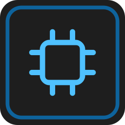

# ADB 上位机（ADB Host Tool）

一款面向嵌入式开发板的 Windows 桌面工具，用 **Python + PySide6** 实现，
界面参考 VS Code / VOFA+ / MobaXterm：左侧导航栏 + 资源管理器、中央多标签页、
底部日志面板、蓝色状态栏，统一深色主题。

除了本机 USB 直连，还支持 **Windows → SSH → Ubuntu → adb → 开发板** 的远程工作方式，
适合开发板插在虚拟机/服务器上的场景。

<p align="center">
  
</p>

---

## 1. 功能一览

| 模块 | 能力 |
| --- | --- |
| **设备管理** | 设备卡片列表、在线状态、无线 (TCP 5555) 连接/断开、adb 路径切换、adb 服务重启、设备自动刷新 |
| **交互终端** | 多标签、多条独立持久 `adb shell`，可同时运行不同命令；支持 5000 行历史、滚轮/滚动条回看、右键智能复制/粘贴、ANSI 颜色、Tab 补全、Ctrl+C、鼠标拖选/双击选词、系统剪贴板、`vi`/`vim`/`nano`/`top`、独立窗口尺寸同步 |
| **命令执行** | 单条命令执行 + 实时流式回显、退出码显示、常用命令预设、可中断 |
| **数据收发** | 文本 / HEX 发送、`\r` `\n` `\0` 追加、覆盖/追加写入、接收轮询（二进制安全）、HEX 视图、保存到本机、写入进程 stdin |
| **TCP 通道** | `adb forward` / `reverse` 端口映射 + 原始 socket 双向收发（文本/HEX） |
| **文件管理** | 左右双栏（本机 / 设备）、**拖拽传输**、多选、整个文件夹递归传输、新建/重命名/删除、在线查看文件、进度条、传输日志 |
| **Logcat** | 实时抓取、级别着色（V/D/I/W/E/F）、关键字/正则过滤、自动滚动、批量刷新（高频日志不卡顿）、保存 |
| **画面 / 截图** | 可切换设备 `screencap` 截图与 RK3568 V4L2 实时摄像头；支持 `/dev/video0`、`/dev/video1`、640×480 / 1280×720、原始/左90°/右90°/180°方向校正、预览停止和当前画面保存 |
| **设置** | 主题、界面字号、等宽字体与终端字号、adb 路径、自动刷新间隔、日志行数与自动滚动、恢复默认布局 |
| **SSH 远程模式** | 连 Ubuntu 后，设备列表/文件/终端/命令全部在 Ubuntu 上执行；左栏变成 Ubuntu 文件系统；一键退出回到本机 |

---

## 2. 快速开始

### 2.1 直接运行 EXE（推荐给使用者）

双击桌面上的 **`ADB_Host_Tool.exe`** 即可，无需安装 Python 或 PySide6。

> EXE 由 `build_windows.bat` 生成，单文件、无控制台窗口。

### 2.2 从源码运行

```powershell
git clone https://github.com/040518/ADB_Host_Tool.git
cd ADB_Host_Tool
pip install -r requirements.txt
python main.py
```

Linux 下同样可用：

```bash
sudo apt install -y python3-pyqt6 python3-pyqt6.qtsvg python3-pyte python3-paramiko
# 或者： pip install -r requirements.txt
python3 main.py
```

### 2.3 依赖说明

| 组件 | 必需 | 说明 |
| --- | --- | --- |
| Python 3.9+ | 源码运行必需 | EXE 已内置 |
| PySide6 | **必需** | 界面框架 |
| pyte | 建议 | 终端模拟（vim 等全屏程序正确显示）；缺失时自动降级 |
| paramiko | 建议 | SSH 远程模式；缺失时回退到 PuTTY 的 plink/pscp |
| **adb** | 需要连设备时 | 外部工具，不随程序打包，需单独安装 platform-tools |

> adb 是 Google 的 Android Platform Tools，程序不会伪造或内嵌它。
> 程序会自动在 PATH、`E:\platform-tools`、`C:\platform-tools`、
> `%LOCALAPPDATA%\Android\Sdk\platform-tools` 等位置查找，也可在「设置 / 设备管理」里手动指定。

---

## 3. SSH 远程模式（板子插在 Ubuntu 上）

点工具栏右上角 **「SSH 连接 Ubuntu…」**：

| 字段 | 示例 |
| --- | --- |
| IP / 主机 | `ubuntu.local` |
| 端口 | `22` |
| 用户名 | `dev` |
| 密码 | 你的 SSH 密码（也支持本机已有密钥） |

连接时会自动保存或更新当前配置（包括密码），下次打开对话框会恢复上次选择；直接从
“已保存”下拉框选中记录后即可连接，不必先点“保存配置”。重复的同一
`用户名@主机:端口` 记录会自动合并，并保留最近的非空密码。

> 密码按用户要求保存在本机 `%APPDATA%\AdbHostTool\ssh_profiles.json` 中，格式为明文；
> 请只在可信电脑上使用，不要把该配置文件提交到 GitHub。

连接后：

- 设备列表来自 **Ubuntu 上的 `adb devices`**
- 文件管理**左栏变成 Ubuntu 的文件系统**，右栏是设备
- 交互终端是**设备的 bash**（`root@ATK-DLRK3568:/#`），等价于在 Ubuntu 上执行 `adb shell`
- TCP 页的 `adb forward` 建在 Ubuntu 上，程序会自动通过现有 SSH 通道连接，无需在 Windows 另开端口映射
- 状态栏显示 `远程 SSH | dev@ubuntu.local`
- 点 **「退出远程」** 立即回到本机 USB 模式

### 3.1 实时摄像头预览

1. 先连接 SSH，并在设备列表中选中 RK3568。
2. 打开左侧 **「截图」** 页面，把顶部模式从 **「设备截图」** 切换为 **「实时摄像头」**。
3. 选择 `/dev/video0` 或 `/dev/video1`、分辨率和画面方向。当前横装模组默认选 **「向左旋转 90°」**。
4. 点 **「开始预览」**；状态栏会显示当前分辨率和 FPS。再次点击可停止。
5. 点 **「保存当前画面」** 可把最近一帧保存为 PNG。

远程模式优先使用长连接 TCP MJPEG：板端 `V4L2 NV12 → FFmpeg MJPEG`，经
`adb forward` 和 SSH 传到 Windows，不让 JPEG 二进制经过旧版 adbd 的 PTY，
可避免花屏。当前 RK3568 实测 640×480 约 **25 FPS**。设备端需提供
`v4l2-ctl`、`ffmpeg` 和 `setsid`；不满足长连接条件时会自动回退到兼容取帧模式。

配置保存在 `%APPDATA%\AdbHostTool\ssh_profiles.json`（Windows）/
`~/.config/AdbHostTool/ssh_profiles.json`（Linux），与 1.x 版本兼容。

> 安全说明：口令只保存在本机配置文件中，不写入日志、不进入命令行参数；
> 建议只在可信网络使用，并给 Ubuntu 账号设置强口令或改用密钥。

---

## 4. 工程结构

```text
ADB_Host_Tool/
├── main.py                   # 入口：QApplication、主题、DPI、调色板
├── core/                     # 业务层（不依赖任何 GUI 库）
│   ├── adb_backend.py        # adb 封装：设备、shell、push/pull、进度解析、ls 解析
│   ├── ssh_backend.py        # SSH 远程：执行 adb、SFTP、PTY shell
│   └── terminal_backend.py   # 持久 adb shell 会话 + pyte 屏幕缓冲
├── ui/                       # 界面层（PySide6）
│   ├── main_window.py        # 主窗口：菜单/工具栏/导航栏/侧边栏/标签页/日志/状态栏
│   ├── context.py            # 应用上下文：状态 + 信号 + 后台任务
│   ├── theme.py              # 配色、资源路径、SVG 图标、设置持久化
│   ├── widgets.py            # 无圆点分隔条等自定义控件
│   ├── terminal_view.py      # 终端绘制控件（QPainter + pyte）
│   ├── sidebar.py            # 设备资源管理器
│   ├── device_page.py        # 设备管理
│   ├── terminal_page.py      # 交互终端
│   ├── command_page.py       # 命令执行
│   ├── data_page.py          # 数据收发
│   ├── tcp_page.py           # TCP 通道
│   ├── file_page.py          # 双栏文件管理（原生拖拽）
│   ├── logcat_page.py        # Logcat
│   ├── screenshot_page.py    # 设备截图 + V4L2 实时摄像头预览
│   ├── settings_page.py      # 设置
│   ├── ssh_dialog.py         # SSH 连接对话框
│   └── text_viewer.py        # 文件查看
├── themes/dark.qss           # 深色主题样式表
├── resources/
│   ├── icons/*.svg           # 105 个线性图标（3 种颜色变体）
│   └── app.ico               # 应用图标
├── tests/                    # 自动化测试
│   ├── test_core.py          # 核心逻辑（无界面）
│   ├── test_ui.py            # 界面、布局、多分辨率、状态联动
│   └── test_remote.py        # 远程模式端到端（真实 SSH + 真实设备）
├── tools/                    # 构建与检查工具
│   ├── make_icons.py         # 生成 SVG 图标
│   ├── make_icon_ico.py      # 生成 app.ico
│   ├── build_spec.py         # 生成 PyInstaller spec
│   ├── shot_pages.py         # 逐页截图
│   └── verify_exe.py         # 验证打包后的 EXE
├── build_windows.bat         # 一键打包并复制到桌面
└── requirements.txt
```

**分层原则**：`core/` 只依赖标准库（+ pyte/paramiko），可被命令行或测试直接调用；
所有耗时操作走 `AppContext.run_async()` 丢到 QThread，结果用 Signal 回到主线程，
界面不做阻塞调用。

---

## 5. 测试

```powershell
# 核心逻辑（无需界面）
python tests/test_core.py

# 界面（需要桌面环境）
python tests/test_ui.py --shots shots

# 终端光标对齐
python tests/test_cursor.py

# 远程模式端到端（需要 Ubuntu + 真实设备）
python tests/test_remote.py
```

远程测试的 SSH 目标可用环境变量覆盖：

```powershell
$env:ADBTOOL_SSH_HOST="ubuntu.local"
$env:ADBTOOL_SSH_PORT="22"
$env:ADBTOOL_SSH_USER="dev"
$env:ADBTOOL_SSH_PASS="your-password"
```

测试结果与「已验证 / 未验证」清单见 [docs/TEST_REPORT.md](docs/TEST_REPORT.md)。

请勿把 `%APPDATA%\AdbHostTool\ssh_profiles.json`、`.env`、测试日志或包含设备信息的
截图提交到公共仓库；项目的 `.gitignore` 已排除这些内容。

---

## 6. 打包

双击 **`build_windows.bat`**，脚本会：

1. 检查 Python 与依赖（缺失则自动 `pip install`）
2. 重新生成图标资源
3. 清理 `build/` `dist/`
4. 生成 spec 并调用 PyInstaller（onefile、无控制台）
5. 检查产物并复制到**真实桌面**（通过 `[Environment]::GetFolderPath('Desktop')`，
   兼容 OneDrive 桌面重定向）

产物：`桌面\ADB_Host_Tool.exe`，双击即用。

验证打包结果：

```powershell
python tools/verify_exe.py dist\ADB_Host_Tool.exe
```

---

## 7. 常见问题

**Q：界面里没有设备？**
- USB：确认数据线支持数据传输、设备已开启「USB 调试」并授权
- 无线：先 `adb connect IP:5555`（可用工具栏的无线连接）
- 板子在 Ubuntu 上：用「SSH 连接 Ubuntu…」

**Q：点「连接终端」提示失败？**
检查 adb 是否可用、设备是否在线；终端页可切换 `xterm-256color` / `vt100`。

**Q：如何同时打开多个交互终端？**
进入「交互终端」后点击 **「新建终端」**。每个标签都有独立会话；标签上的关闭按钮
只结束该终端，不影响其他标签。顶部快捷命令、清屏、复制和粘贴都作用于当前标签。

**Q：终端如何补全、选择和复制文字？**
输入命令前缀后按 **Tab** 补全。按住鼠标左键拖选文字，或双击选择一个词；然后按
**Ctrl+Shift+C**或点击顶部「复制」。右键行为与 VS Code 终端一致：**有选区时复制，
复制后自动取消选中；没有选区时粘贴**。也可用 Ctrl+Shift+V、Ctrl+Insert / Shift+Insert。滚轮或右侧滚动条可回看最多 5000 行历史；
键入新内容时会自动回到最新输出。

新建终端只显示一次设备提示符；窗口尺寸同步在后台去重执行，不会额外刷出提示符。

**Q：为什么 SSH 历史配置没有自动填入密码？**
新版会在对话框打开时立即加载上次选择的完整记录，选择其他历史项也会同步恢复密码。
点击“连接”会自动更新该记录，因此不再需要先点“保存配置”。

**Q：vim 里显示乱码/排版错乱？**
需要安装 pyte（`pip install pyte`）；缺失时终端会降级为纯文本模式。

**Q：远程模式下终端怎么不是 Ubuntu 的 shell？**
这是设计如此：终端是**设备的 bash**，等价于在 Ubuntu 上执行 `adb shell`。
需要操作 Ubuntu 本身请直接使用 SSH 客户端。

**Q：设备没有 logcat？**
部分 Buildroot 设备不带 logcat，可在「命令执行」页用 `dmesg` / `journalctl`。

**Q：实时摄像头画面花屏或帧率只有约 2 FPS？**
确认状态文字显示 **「长连接流式」**。若显示兼容模式，请检查设备端是否有
`v4l2-ctl` / `ffmpeg` / `setsid`，Ubuntu 是否有 `nc`，以及 `adb forward` 是否可用。

**Q：远程模式下 TCP 通道连接哪个地址？**
照常填写“本机端口”和“设备端口”并先建立 forward。该“本机端口”实际位于 Ubuntu，
程序会复用 SSH 连接自动访问它；不要在 Windows 上另外运行 `adb forward`。

**Q：摄像头画面横着或倒着？**
在实时摄像头顶部的方向下拉框选择「向左旋转 90°」「向右旋转 90°」或「旋转 180°」。
方向校正在 Windows 显示层完成，不修改 RKISP 驱动；保存当前画面时会保存校正后的方向。

---

## 8. 版本

- **2.0.0** — PySide6 重写：VS Code 风格界面、9 个功能模块、原生拖拽、
  深色主题、SVG 图标、单文件 EXE 交付
- **1.3.0** — 新增 SSH 远程模式
- **1.2.0** — 新增交互式终端（MobaXterm 风格）
- **1.1.0** — 新增双栏文件管理与拖拽传输
- **1.0.0** — 初版（设备管理、命令、数据收发、TCP、文件、logcat、截图）

---

## 9. 开源许可证

本项目采用 [MIT License](LICENSE)。欢迎在保留许可证与版权声明的前提下使用、修改和分发。
